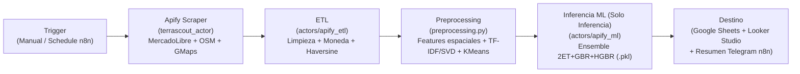

# TerraScout & EcoCamp AI — Pipeline de Tierras Turísticas (MercadoLibre + Apify + ML)

> **Scraping, ETL geoespacial, EDA y valuación hedónica con Machine Learning para detectar oportunidades de arbitraje en terrenos turísticos (campings / glampings) en las Sierras de Córdoba (Punilla y Calamuchita).**
>
> *Samsung Innovation Campus 2026 — Capstone Project (Producto 1 + Producto 2)*

---

## 1. Arquitectura y flujo



* **Política ZERO DUMMY DATA:** `100%` datos reales (`1.200` avisos de Mercado Libre, `288` campings OSM/SoloCampings, `237` perfiles y `1.754` reseñas de Google Maps, `16` localidades topográficas NASA SRTM/MODIS/IGN).
* **Reglas desacopladas:** todos los umbrales de negocio y parámetros ML viven en [`config/business_rules.json`](./config/business_rules.json) (auditoría Samsung).

---

## 2. Estructura del repositorio

```text
Capstone/
├── terrascout_actor/                     # Actor Scraper (MercadoLibre, OSM, SoloCampings, GMaps, NLP)
│   ├── my_actor/main.py
│   ├── .actor/
│   ├── Dockerfile
│   └── requirements.txt
├── actors/
│   ├── apify_etl/                        # Actor 1: ETL (limpieza, moneda, superficie, JOIN Haversine)
│   │   ├── my_actor/{main.py, etl_core.py, sdk_compat.py}
│   │   ├── .actor/{actor.json, input_schema.json, output_schema.json, dataset_schema.json}
│   │   ├── Dockerfile
│   │   └── requirements.txt
│   ├── apify_eda/                        # Actor 2: EDA (correlaciones, tablas y Excel Dashboard)
│   │   ├── my_actor/{main.py, eda_core.py, sdk_compat.py}
│   │   ├── .actor/
│   │   ├── Dockerfile
│   │   └── requirements.txt
│   └── apify_ml/                         # Actor 3: Solo Inferencia ML (Producto 2)
│       ├── my_actor/{main.py, preprocessing.py, tooling_business.py, sdk_compat.py}
│       ├── .actor/
│       ├── Dockerfile
│       └── requirements.txt
├── notebooks/                            # Notebooks de análisis (EDA) y entrenamiento (ML)
│   ├── 01_etl_y_eda.ipynb                # Analytics: ETL trazable, correlaciones y voz del turista
│   └── 02_modelado_hedonico.ipynb        # Training: CV 5-Fold, Ensemble, arbitraje y verificación .pkl
├── data/
│   ├── aux_topografia_cordoba.csv        # Relieve, NDVI y riesgo ambiental de 16 localidades
│   ├── raw/                              # Fuentes reales crudas + dataset_raw_consolidado.xlsx
│   └── processed/                        # dataset_limpio.csv, dashboard/ (P1) y producto2/ (P2)
├── models/
│   └── terrascout_pipeline.pkl           # Modelo hedónico serializado en Pickle (dif_max = 0.0)
├── workflows/                            # Automatización en n8n
│   ├── README-n8n.md                     # Guía rápida de importación y configuración n8n
│   ├── n8n_producto1_terrascout.json     # Flujo Producto 1 (ETL -> Drive -> EDA -> Sheets)
│   ├── n8n_producto2_terrascout.json     # Flujo Producto 2 (ETL -> Drive -> ML -> Sheets)
│   └── n8n_terrascout_completo.json      # Flujo unificado para demo (ETL -> EDA P1 + ML P2)
├── config/
│   └── business_rules.json               # Reglas de negocio y parámetros ML desacoplados
├── src/
│   ├── run_scraper_node.py               # CLI local de extracción en vivo hacia data/raw/
│   ├── run_producto1_pipeline.py         # CLI local Producto 1 (ETL + EDA + Dashboard)
│   ├── training.py                       # Entrenamiento anti-leakage y validación CV (fuera del Actor)
│   └── run_producto2_pipeline.py         # CLI local Producto 2 (Entrenamiento e inferencia --infer-only)
├── tests/                                # 43 tests automatizados (pytest, incluye R1-R4 Apify)
├── docs/                                 # Documentación completa, guía Looker Studio y planificación
└── README.md
```

---

## 3. Actores de Apify

Todos los actores cumplen las reglas de diseño Apify R1–R4 (`my_actor/main.py` puro sin lógica pesada ni loops, lectura/escritura por SDK Apify y fallback local).

| Actor | Código | Input Schema | Output Schema | Cómo correrlo |
| :--- | :--- | :--- | :--- | :--- |
| **Scraper (`terrascout_actor`)** | [`terrascout_actor/my_actor/main.py`](./terrascout_actor/my_actor/main.py) | [`input_schema.json`](./terrascout_actor/.actor/input_schema.json) | [`output_schema.json`](./terrascout_actor/.actor/output_schema.json) | `cd terrascout_actor && apify run` |
| **Actor 1: ETL (`ypvpGbmD1vpqraNXA`)** | [`actors/apify_etl/my_actor/main.py`](./actors/apify_etl/my_actor/main.py) | [`input_schema.json`](./actors/apify_etl/.actor/input_schema.json) | [`output_schema.json`](./actors/apify_etl/.actor/output_schema.json) | `cd actors/apify_etl && apify run` |
| **Actor 2: EDA (`YZH8ti7zjLt6410Hx`)** | [`actors/apify_eda/my_actor/main.py`](./actors/apify_eda/my_actor/main.py) | [`input_schema.json`](./actors/apify_eda/.actor/input_schema.json) | [`output_schema.json`](./actors/apify_eda/.actor/output_schema.json) | `cd actors/apify_eda && apify run` |
| **Actor 3: Inferencia ML (`terrascout-ml-actor`)** | [`actors/apify_ml/my_actor/main.py`](./actors/apify_ml/my_actor/main.py) | [`input_schema.json`](./actors/apify_ml/.actor/input_schema.json) | [`output_schema.json`](./actors/apify_ml/.actor/output_schema.json) | `cd actors/apify_ml && apify run` |

---

## 4. Funciones de ETL, preprocessing y modelo

| Función | Archivo | Input | Output | Descripción |
| :--- | :--- | :--- | :--- | :--- |
| `scrape_mercadolibre()` / `execute_terrascout_pipeline()` | [`ml_scraper.py`](./terrascout_actor/my_actor/ml_scraper.py) / [`nlp_analysis.py`](./terrascout_actor/my_actor/nlp_analysis.py) | HTML / JSON-LD MercadoLibre, OSM, GMaps | CSVs / JSON crudos (`data/raw/`) | Extrae terrenos, campings, reseñas y tópicos NLP |
| `run_etl_pipeline()` | [`etl_core.py`](./actors/apify_etl/my_actor/etl_core.py) | Datos crudos + `business_rules.json` | `dataset_limpio.csv` (`894` filas) + funnel | Normaliza ARS→USD, rescata m² con regex segura, filtra IQR, deduplica y hace JOIN espacial Haversine |
| `enrich_ml_features()` | [`preprocessing.py`](./actors/apify_ml/my_actor/preprocessing.py) | `dataset_limpio.csv` + reglas | Matriz de features enriquecidas | Corrige localidades sin GPS por alias, calcula `log1p(m²)`, distancias a 16 centroides y señales de texto |
| `build_preprocessor()` + `train_and_evaluate_hedonic_model()` | [`src/training.py`](./src/training.py) | Datos limpios enriquecidos | `terrascout_pipeline.pkl` + métricas CV/Test | Entrenamiento fuera del Actor: split 80/20 anti-leakage, `ColumnTransformer` (`KMeans` geo + `TF-IDF/SVD`), 5-Fold CV sobre 7 modelos y check Pickle `dif_max < 1e-6` |
| `score_opportunities()` + `execute_ml_actor()` | [`tooling_business.py`](./actors/apify_ml/my_actor/tooling_business.py) | Lotes limpios + `.pkl` + reglas | `predicciones_producto2.csv` + `oportunidades_producto2.csv` | Inferencia pura en Apify: estima valor justo USD/m², calcula `gap_arbitraje_pct`, aplica reglas ambientales y marca `flag_revision` |

### Modelo seleccionado

* **Modelo ganador:** `Ensemble (2 × ExtraTrees + GradientBoosting + HistGradientBoosting)` (`VotingRegressor`, target `log(precio_m2_usd)`).
* **¿Por qué?** Obtuvo el mejor desempeño conjunto en validación cruzada 5-Fold (`R² CV = 0.5964 ± 0.0618`) y en el conjunto de test no visto (`R² Test = 0.6037`, `MAE = 6.45 USD/m²`, `RMSE = 11.55 USD/m²`), combinando la estabilidad de árboles aleatorizados (`ExtraTrees`) con la capacidad de capturar relaciones no lineales de boosting (`GBR` + `HGBR`).
* **Alternativas evaluadas y descartadas:**
  * `ExtraTrees` solo (`R² CV = 0.5956 ± 0.0495`, `R² Test = 0.5824`, `MAE = 6.58`, `RMSE = 11.95`): ligeramente menor generalización en test.
  * `RandomForestRegressor` (`R² CV = 0.5771 ± 0.0647`, `R² Test = 0.5773`, `MAE = 6.69`, `RMSE = 11.89`): mayor error medio que el ensemble.
  * `GradientBoostingRegressor` (`R² CV = 0.5708 ± 0.0822`, `R² Test = 0.5742`, `MAE = 6.57`, `RMSE = 11.57`): mayor varianza entre folds (`std = 0.0822`).
  * `HistGradientBoostingRegressor` (`R² CV = 0.5673 ± 0.0670`, `R² Test = 0.5927`, `MAE = 6.71`, `RMSE = 11.17`): buen RMSE pero menor `R² CV` individual.
  * `Ridge Linear` (`R² CV = 0.4892 ± 0.0516`, `R² Test = 0.5268`, `MAE = 7.48`, `RMSE = 12.62`): subajusta relaciones espaciales no lineales.
  * `Baseline DummyRegressor` (`R² CV = -0.0204 ± 0.0373`, `R² Test = -0.0157`, `MAE = 10.19`, `RMSE = 15.73`): línea base de referencia superada en `-36.7%` de MAE.

---

## 5. Contrato del actor de inferencia (`actors/apify_ml`)

| Campo | Dirección | Tipo de dato | Descripción |
| :--- | :---: | :---: | :--- |
| `dataset_limpio_url` / `records` | `input` | `string` / `array` | URL (Drive / KV Store / ruta local) o registros JSON de `dataset_limpio.csv` |
| `rules_json_url` | `input` | `string` | Ruta o URL a `config/business_rules.json` (reglas y umbrales de arbitraje) |
| `model_pkl_url` | `input` | `string` | Ruta o URL a `terrascout_pipeline.pkl` pre-entrenado con `src/training.py` para inferencia pura |
| `ids_ya_alertados` | `input` | `array<string>` | Lista opcional de `id_registro` previos para evitar alertas duplicadas |
| `precio_modelo_m2` | `output` | `float` | Valor justo estimado por el modelo hedónico en `USD/m²` |
| `precio_modelo_total_usd` | `output` | `float` | Valuación total estimada del lote (`precio_modelo_m2 × superficie_m2`) |
| `gap_arbitraje_pct` | `output` | `float` | Porcentaje de subvaluación `(precio_modelo_m2 - precio_m2_usd) / precio_modelo_m2 × 100` |
| `es_oportunidad_ml` | `output` | `boolean` | `true` si `gap >= 20%`, `pendiente <= 12°` y `riesgo_ambiental != "ALTO"` |
| `flag_revision` | `output` | `string` | `"REVISAR"` si `gap_arbitraje_pct >= 50%` (posible error de publicación), sino `"OK"` |

---

## 6. Métricas

* **Métricas de negocio (objetivo comercial para Diana):**
  * **Tasa de inviabilidad técnica:** reducción del `10%` al `0%` en alertas enviadas (exclusión automática de riesgo ambiental `ALTO` y pendientes `> 12°`).
  * **Margen de arbitraje objetivo:** detección automática de lotes publicados con descuento `>= 20%` (`244` oportunidades P1 por mediana zonal y `184` oportunidades P2 validadas por modelo hedónico ML).
  * **Impacto financiero:** ahorro de `12 hs/semana` de relevamiento manual, costo operativo de `USD 65/mes` (vs. tope `USD 150/mes`), **Payback en `2,34 meses`** y **ROI Neto Año 1 de `+411%`**.
* **Métricas del modelo ML (conjunto real `894` terrenos, split `80/20` estratificado + 5-Fold CV):**
  * `R² CV (5-Fold)`: **`0.5964 ± 0.0618`**
  * `R² Test (log)`: **`0.6037`**
  * `MAE Test`: **`6.45 USD/m²`** *(vs. `10.19 USD/m²` del baseline Dummy)*
  * `RMSE Test`: **`11.55 USD/m²`** *(vs. `15.73 USD/m²` del baseline Dummy)*
  * Verificación serialización Pickle: **`dif_max = 0.00e+00`** (`< 1e-6`).

---

## 7. Costo computacional de una corrida de inferencia

Medición real ejecutando `run_producto2_inference()` sobre los **`894` registros** de `dataset_limpio.csv` con `models/terrascout_pipeline.pkl`:

| Concepto | Inferencia (`--infer-only`) | Reentrenamiento completo (`7` modelos + 5-Fold CV) |
| :--- | :--- | :--- |
| **Tiempo por corrida** | **`0.31 s`** local (`~10 s` en Apify con cold-start) | `~61 s` local (`~75 s` en Apify) |
| **Memoria / CPU / GPU** | **`412.3 MB` RAM pico** → `512 MB – 1 GB / 1 vCPU / Sin GPU` | `512 MB – 1 GB / 1 vCPU / Sin GPU` |
| **Costo en Apify (`~$0.30/CU`)** | **`~0.0028 CU`** ≈ **`USD 0.0008`** por corrida *(1 GB × 10 s)* | `~0.021 CU` ≈ **`USD 0.006`** por corrida |
| **Costo estimado por 1.000 registros** | **`< USD 0.001`** *(CPU puro, sin LLM ni GPU)* | `~USD 0.007` |

*(Nota: el presupuesto operativo mensual de `USD 65/mes` está dominado por el plan Apify Starter `USD 39/mes` y orquestación `USD 10.59/mes`; el cómputo de inferencia ML es prácticamente despreciable).*

---

## 8. Cómo correr el proyecto

1. **Actores Apify:**
   ```bash
   cd actors/apify_etl && apify run   # Paso 1: ETL -> dataset_limpio.csv
   cd actors/apify_eda && apify run   # Paso 2: EDA -> Dashboard CSVs/XLSX
   cd actors/apify_ml  && apify run   # Paso 3: ML  -> inferencia (predicciones + oportunidades)
   ```
2. **Notebooks (Google Colab o Jupyter):**
   * Análisis y EDA: abrir [`notebooks/01_etl_y_eda.ipynb`](./notebooks/01_etl_y_eda.ipynb).
   * Entrenamiento, arbitraje y prueba Pickle: abrir [`notebooks/02_modelado_hedonico.ipynb`](./notebooks/02_modelado_hedonico.ipynb).
3. **Ver datos y salidas:**
   * Crudos reales en [`data/raw/`](./data/raw/) y topografía en [`data/aux_topografia_cordoba.csv`](./data/aux_topografia_cordoba.csv).
   * Procesados en [`data/processed/dataset_limpio.csv`](./data/processed/dataset_limpio.csv), [`data/processed/dashboard/`](./data/processed/dashboard/) y [`data/processed/producto2/`](./data/processed/producto2/).
4. **Automatización n8n:** ver [`workflows/README-n8n.md`](./workflows/README-n8n.md) (flujos listos para importar de Producto 1 y Producto 2).

### Ejecución rápida en local (Python)

```bash
cp .env.example .env
pip install -r requirements.txt

# Producto 1 (ETL -> dataset_limpio.csv -> EDA -> Dashboard CSVs/XLSX)
python3 src/run_producto1_pipeline.py

# Producto 2 (Entrenamiento 7 modelos + models/terrascout_pipeline.pkl + oportunidades ML)
python3 src/run_producto2_pipeline.py

# Producto 2 solo inferencia sobre lote nuevo (sin reentrenar)
python3 src/run_producto2_pipeline.py --infer-only --input data/processed/dataset_limpio.csv

# Suite completa de verificación (43 tests: scrapers, ETL, EDA, ML, R1-R4 Apify)
PYTHONPATH=terrascout_actor python3 -m pytest tests/test_scraper_node.py tests/test_producto1_actors.py tests/test_producto2_ml.py -v
```

> Con este pipeline podés extraer terrenos y campings reales de Córdoba, limpiarlos y cruzarlos espacialmente, predecir su valor justo por m² con Machine Learning y detectar oportunidades de compra subvaluadas con blindaje ambiental.