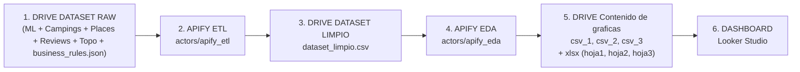

# Flujo Producto 1 en Make / n8n y Diseño de Datos para Dashboard

Este documento conecta los **2 Actores de Apify** ([`actors/apify_etl/`](../actors/apify_etl/.actor/actor.json) y [`actors/apify_eda/`](../actors/apify_eda/.actor/actor.json)) con el diagrama de referencia de la cátedra (`ObjetivoFlujo_N8n|make.png`) y detalla cómo alimentar el Dashboard en **Looker Studio** / **Google Sheets**.

---

## 1. Correspondencia 1 a 1 con el Diagrama de la Profe



---

## 2. Cómo conectar los 2 Actores en Make o n8n

### Paso A — Input desde Drive (Caja 1 → Caja 2: `APIFY ETL`)
* Compartir los archivos de `data/raw/`, `data/aux_topografia_cordoba.csv` y `config/business_rules.json` en Google Drive con permiso de lectura (*Cualquiera con el enlace*), o usar los links `raw.githubusercontent.com`.
* En el módulo **Apify -> Run an Actor** (Make) o **HTTP Request POST** (n8n) hacia `terrascout-etl-actor`, pasar el JSON:
  ```json
  {
    "ml_csv_url": "<URL_DRIVE_O_GITHUB_ML>",
    "campings_csv_url": "<URL_DRIVE_O_GITHUB_CAMPINGS>",
    "places_csv_url": "<URL_DRIVE_O_GITHUB_PLACES>",
    "topo_csv_url": "<URL_DRIVE_O_GITHUB_TOPO>",
    "rules_json_url": "<URL_DRIVE_O_GITHUB_BUSINESS_RULES>"
  }
  ```
* *(Nota: tanto `apify_etl` como `apify_eda` convierten automáticamente links `drive.google.com/file/d/.../view` a descarga directa `uc?export=download&id=...`).*

### Paso B — Guardar Dataset Limpio en Drive (Caja 2 → Caja 3)
* `yonihiriart/terrascout-etl-actor` (`ypvpGbmD1vpqraNXA`) guarda en su **Key-Value Store**:
  * `dataset_limpio.csv`
  * `etl_funnel.json` (incluye **`dataset_limpio_public_url`** firmada con `?signature=...`, lista para descargar sin token desde Make, n8n, Google Drive o Actor 2).
* En Make/n8n: leer `https://api.apify.com/v2/key-value-stores/{defaultKeyValueStoreId}/records/etl_funnel.json`, tomar `dataset_limpio_public_url`, descargarlo con **HTTP -> Get a File** y subirlo a Google Drive (`Google Drive -> Upload a File` en carpeta `02_DATASET_LIMPIO`) reemplazando `dataset_limpio.csv`.

### Paso C — Correr `APIFY EDA` y generar Contenido de Gráficas (Caja 3 → Caja 4 → Caja 5)
* Llamar a `yonihiriart/terrascout-eda-actor` (`YZH8ti7zjLt6410Hx`) pasándole en `dataset_limpio_url` la **`dataset_limpio_public_url`** de `etl_funnel.json` (o el link público de Drive de la Caja 3), más opcionalmente `reviews_csv_url`, `topicos_json_url` y `topo_csv_url`.
* Desde `eda_summary.json` (campo `public_urls`) o directamente del `defaultKeyValueStoreId` del Actor 2, descargar con sus URLs firmadas los **4 archivos** y subirlos a `03_CONTENIDO_GRAFICAS` de Drive:
  1. `csv_1_localidades_y_riesgo.csv` (**`hoja1`**)
  2. `csv_2_correlaciones_y_distribuciones.csv` (**`hoja2`**)
  3. `csv_3_oportunidades_y_voz_turista.csv` (**`hoja3`**)
  4. `contenido_graficas_dashboard.xlsx` (Excel único con las pestañas **`hoja1`**, **`hoja2`**, **`hoja3`**).

---

## 3. Qué gráfico armar en Looker Studio con cada CSV / Hoja

### `csv_1_localidades_y_riesgo.csv` (`hoja1`) — **Vista "¿Dónde invertir / Qué vender?"**
* **Mapa geográfico (Google Maps en Looker):** usar `coordenadas_gmaps` (`lat,lon`), tamaño = `cantidad_lotes`, color = `precio_m2_mediano_usd` o `riesgo_ambiental`.
* **Scorecards superiores:** Total lotes (`SUM(cantidad_lotes)`), Oportunidades Producto 1 (`SUM(oportunidades_p1_count)`), Mediana USD/m².
* **Scatter / Burbujas (Demanda vs Riesgo):** eje X = `nps_proxy_zona_mediana` (competencia débil o fuerte), eje Y = `ndvi_sombra_verano` o `precio_m2_mediano_usd`, color = `riesgo_ambiental`.
* **Tabla resumen por localidad:** `barrio_localidad`, `valle_corredor`, `cantidad_lotes`, `precio_m2_mediano_usd`, `pendiente_media_grados`, `campings_5km_mediana`, `pct_con_escritura`.

### `csv_2_correlaciones_y_distribuciones.csv` (`hoja2`) — **Vista "¿Por qué cambian los precios? (EDA)"**
* **Gráfico de barras (Correlaciones reales):** filtrar `bloque = "correlacion_features"`, dimensión = `variable_o_grupo`, métricas = `pearson_m2`, `spearman_m2`, `info_mutua_m2` (destacando que `superficie_m2` e `info_mutua` de `nps_proxy_zona` capturan relaciones no lineales).
* **Tabla de Asimetría y Justificación estadística:** filtrar `bloque = "distribucion_asimetria"` (`media`, `mediana`, `std`, `skew` antes y después de `log_precio_m2_usd`).
* **Barras agrupadas (Cruce Valle × Riesgo):** filtrar `bloque = "cruce_valle_riesgo"`, dimensión = `variable_o_grupo` (`valle_corredor`) y desglose = `subgrupo` (`riesgo_BAJO/MEDIO/ALTO`), métrica = `mediana`.

### `csv_3_oportunidades_y_voz_turista.csv` (`hoja3`) — **Vista "¿A qué precio / Qué destacar a Diana?"**
* **Tabla accionable de Oportunidades (Radar de Precios Producto 1):** filtrar `seccion = "oportunidad_lote"` y `es_oportunidad_p1 = true` → muestra `id_registro`, `barrio_localidad`, `titulo_publicacion`, `precio_usd`, `superficie_m2`, `precio_m2_usd`, `precio_referencia_zona_m2`, `descuento_vs_mediana_pct`, `telefono_en_descripcion`, y enlaces clicables `url_publicacion` y `url_google_maps`.
* **Gráfico de Torta / Barras (Voz del Turista):** filtrar `seccion = "voz_turista_estrellas"` → distribución real de `1★` a `5★` (`1.754` reseñas).
* **Barras horizontales (Top Quejas + Keywords de Infraestructura):** filtrar `seccion = "topico_queja_gmaps"` y `seccion = "infraestructura_keyword"` → qué dolores tienen los campings actuales para que Diana los use como argumento de venta.
