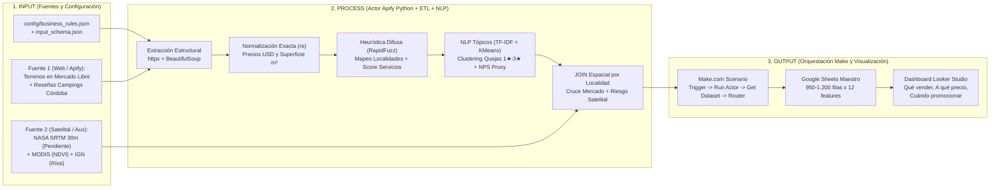

# TerraScout & EcoCamp AI — Plan Maestro de Cierre e Implementación del Producto 1

> **Guía Ejecutiva y Técnica para el Inicio del Desarrollo (Producto 1 — Entrega 12/11)**  
> **Programa**: Samsung Innovation Campus (SIC) 2026 — Capstone Project (Clases 42 a 47)  
> **Equipo Consultor**: **TerraScout AI**  
> **Autor / Coordinación**: Líder Técnico / Solution Engineer (SE), en conjunto con Data Analyst / Scientist (DS) y Business Analyst (BIZ)  
> **Referencias Base del Curso**:  
> - Propuesta Base: [`propuesta_terrascout_ai.md`](./propuesta_terrascout_ai.md)  
> - Marco Satelital sin Series Temporales: [`proyecto_satelital_sin_series_temporales.md`](./proyecto_satelital_sin_series_temporales.md)  
> - Plantilla Oficial de Actor Apify de la Cátedra: `tarea_ejemplo_apify` (adaptada en `./terrascout_actor/`)  
> - Escalera TDD de Herramientas (Clase 42): `TDD_re_a_MCP_observatorio_precios.ipynb`  
> - Cronograma y Rúbrica Docente: `capstone_project_cronograma_profe.xlsx` y `criterios_seleccion_dataset.webp`

---

## 1. ¿Qué Debemos Cerrar PRIMERO antes de Empezar a Armar el Producto 1?

Como **Líder Técnico (Solution Engineer)**, antes de tirar la primera línea de código o armar el escenario en Make, tenés que **congelar 6 definiciones estructurales** con el Business Analyst (BIZ) y el Data Analyst/Scientist (DS). Si estas 6 cosas quedan cerradas hoy, los 3 roles pueden trabajar en paralelo sin pisarse ni retrabajar.

### 1.1. Cierre #1: Encuadre Exacto del Rol de Diana y la Pregunta de Negocio
Según `capstone_project_cronograma_profe.xlsx` (`Guía Business` y `Resumen`), Diana es directora de una comercializadora multicanal (equipo de 3 personas, 12 hs/semana relevando a mano a USD 8/h, 10% de error de carga manual, meta de USD 15.000/mes, NPS actual de 22, presupuesto tope de USD 2.500 one-off + USD 150/mes).
* **Qué cerramos**: Diana abre una **unidad de intermediación comercial y corretaje de tierras turísticas y de acampe/glamping** (o venta de paquetes/inversiones modulares en tierras turísticas) en las **Sierras de Córdoba**.
* **Las 3 preguntas obligatorias del Producto 1 que nuestro Dashboard debe responder**:
  1. **¿Qué vender / intermediar?**: Lotes y zonas en **Valle de Calamuchita y Valle de Punilla** que combinen alta demanda turística insatisfecha (campings cercanos con **NPS Proxy bajo** por falta de sombra, mal acceso o saturación) y **aptitud ambiental certificada** (pendiente $\le 12^\circ$, fuera de cota de inundación y buen índice de vegetación/arboleda).
  2. **¿A qué precio?**: Al valor por $\text{m}^2$ normalizado en USD por localidad y servicios, identificando terrenos publicados un **$\ge 20\%$ por debajo del valor mediano/esperado de su zona** (oportunidades de arbitraje inmobiliario).
  3. **¿Cuándo promocionar / actuar?**: Alertar inmediatamente cuando ingresa una publicación subvaluada con riesgo ambiental bajo o cuando los complejos turísticos de la localidad sufren picos de quejas estacionales en Google Maps.

### 1.2. Cierre #2: Cumplimiento Estricto de la Regla de "Máximo 2 Fuentes y 2 Fenómenos"
La infografía `criterios_seleccion_dataset.webp` y el documento [`proyecto_satelital_sin_series_temporales.md`](./proyecto_satelital_sin_series_temporales.md) exigen **no más de 2 fuentes principales** y **2 fenómenos de distinta naturaleza** en un **corte transversal espacial (sin series temporales)**:
* **Fenómeno 1 (Dinámica Comercial y Voz del Turista — Fuente 1: Extracción Web vía Apify)**:
  * Oferta inmobiliaria de terrenos y lotes en venta en Sierras de Córdoba (precios en USD, superficie en $\text{m}^2$, servicios declarados, descripción libre) + Puntos de interés y reseñas de campings/glampings de la misma localidad (estrellas $1\star\text{ a }5\star$ y texto de reseñas para calcular **NPS Proxy** y tópicos de quejas).
* **Fenómeno 2 (Aptitud Biofísica y Riesgo Ambiental — Fuente 2: Datos Satelitales y Geográficos Abiertos NASA / IGN)**:
  * **Corte transversal espacial (foto estática por localidad/zona, no película temporal)**:
    * **Pendiente media ($^\circ$) y Altitud ($\text{m s.n.m.}$)**: Modelo Digital de Elevación **NASA SRTM 30m**.
    * **Vigor de Vegetación / Sombra ($\text{NDVI medio de verano}$)**: Reflectancia en rojo e infrarrojo cercano (**NASA MODIS/VIIRS**), siguiendo la nota técnica obligatoria de `proyecto_satelital_sin_series_temporales.md` (*declarar que el NDVI sale de reflectancia óptica rojo/NIR y no de radiancia cruda*).
    * **Distancia a Red Hídrica ($\text{m}$) y Rutas ($\text{km}$)**: Cartografía oficial del **IGN (Instituto Geográfico Nacional)**.

### 1.3. Cierre #3: Diccionario Normalizado de Localidades (`barrio_localidad`)
El problema técnico #1 cuando DS y SE intentan unir (`JOIN`) datos de Mercado Libre con datos satelitales es que en Mercado Libre escriben `"Sta. Rosa de Calamuchita"`, `"Santa Rosa"`, `"V. Gral Belgrano"` o `"Villa Carlos Paz Centro"`.
* **Qué cerramos**: Definir un **Catálogo Maestro de 16 Localidades Serranas** (8 en Calamuchita y 8 en Punilla) y usar **`unicodedata` + `RapidFuzz` (`WRatio` / `token_set_ratio`, umbral 85)** —exactamente como en `tarea_ejemplo_apify/my_actor/main.py`— para mapear cualquier variante de texto al `id_localidad` canónico antes de hacer el `JOIN` con `aux_topografia_cordoba.csv`.

### 1.4. Cierre #4: Cómo Aprovechar el Ejemplo de la Profe (`tarea_ejemplo_apify`)
La profesora nos dejó en `tarea_ejemplo_apify` un Actor de Apify en Python sumamente completo que **debemos reutilizar como arquitectura base de nuestro Actor del Producto 1**.
Mirá lo que ya tiene `tarea_ejemplo_apify/my_actor/main.py` y cómo encaja 100% con TerraScout AI:

| Componente en `tarea_ejemplo_apify` | Qué hace en el ejemplo (`mcgee-scraper`) | Cómo lo adaptamos en **TerraScout AI (Producto 1)** |
| :--- | :--- | :--- |
| **`Actor.get_input()` + `.actor/input_schema.json`** | Lee `url`, `words`, `threshold`, `scorer`, `top_topics`, `n_clusters`, `stop_words`. | Lee las URLs/consultas de lotes y campings en Córdoba, la lista de `words` clave de infraestructura (`["agua", "luz", "escritura", "asfalto", "arboleda", "inundable"]`), el `tipo_cambio_ars_usd` y parámetros de clustering. |
| **`AsyncClient` (`httpx2`) + `BeautifulSoup(..., 'lxml')`** | Descarga páginas de forma asíncrona, limpia `nav/header/footer` y extrae texto limpio por bloque. | Descarga los listados/fichas o procesa los HTML/JSON extraídos sin romperse ante cambios de atributos HTML (cumpliendo la lección de `TDD_re_a_MCP_observatorio_precios.ipynb`). |
| **`normalize()` + `tokenize()` + `SentenceIndex`** | Pasa a minúsculas, quita tildes con `unicodedata.normalize('NFKD')` y arma un índice de n-gramas por oración. | Normaliza títulos y descripciones de lotes inmobiliarios y reseñas en español de campings serranos. |
| **`fuzzy_count()` con `RapidFuzz`** | Cuenta apariciones exactas y aproximadas (tolerando errores de tipeo) devolviendo `count`, `sentences` y `variants`. | **Extracción inteligente de features**: detecta si un lote tiene servicios (`agua`, `luz`, `escritura`), acceso o riesgo, incluso cuando el vendedor escribe con faltas de ortografía (*"escriturado"*, *"escrirura"*, *" trifasica"*), y unifica nombres de localidades. |
| **`find_topics()` con `TfidfVectorizer` + `KMeans` + `silhouette_score`** | Agrupa oraciones en clusters eligiendo $k$ automáticamente por Silhouette y extrae las palabras clave de cada centroide (`topic_terms`). | **Descubrimiento automático del Dolor del Turista**: agrupa las oraciones de reseñas negativas ($1\star\text{–}3\star$) de los campings competidores en tópicos (ej. *Tópico 1: falta de sombra/árboles*, *Tópico 2: calles de tierra intransitables con lluvia*, *Tópico 3: baños/enchufes*) para responder la Pregunta 4 de Diana en el Pitch. |
| **`.actor/dataset_schema.json` + `Actor.push_data()`** | Guarda la salida estructurada en el Dataset de Apify y define la vista tabular `overview`. | Publica las filas limpias del dataset listas para que **Make** las lea y las inserte en **Google Sheets -> Looker Studio**. |

### 1.5. Cierre #5: Contrato de Columnas del Dataset Consolidado (12 Features Maestras)
Para cumplir con `criterios_seleccion_dataset.webp` (**700 a 2.000 registros** y **~10 a 12 features**), congelamos la estructura exacta de la tabla `terrascout_dataset_producto1.csv` que irá a Google Sheets:

| # | Columna | Tipo | Naturaleza / Fenómeno | Fuente | Cómo se calcula / extrae |
| :-: | :--- | :--- | :--- | :--- | :--- |
| 1 | `id_registro` | `string` | Identificador | Apify (ML) | ID único de publicación (`MLA-...`). |
| 2 | `valle_corredor` | `string` | Geográfica (Macro) | Normalizador | `"Valle de Calamuchita"` o `"Valle de Punilla"`. |
| 3 | `barrio_localidad` | `string` | Geográfica (Clave JOIN) | RapidFuzz + IGN | Nombre canónico de la localidad (16 localidades). |
| 4 | `precio_usd` | `float` | Fenómeno 1 (Mercado) | Regex / Apify | Precio llevado a USD (si está en ARS se divide por `tipo_cambio_ars_usd` de `business_rules.json`). |
| 5 | `superficie_m2` | `float` | Fenómeno 1 (Mercado) | Regex (`re`) | Metros cuadrados extraídos de atributos o título (`500` a `20.000` $\text{m}^2$). |
| 6 | `precio_m2_usd` | `float` | **Target / Variable Clave** | Calculada | ` round(precio_usd / superficie_m2, 2)`. |
| 7 | `score_servicios` | `int` | Fenómeno 1 (Infraestructura) | `fuzzy_count` (RapidFuzz) | Puntaje de $0$ a $3$ según mención difusa de: Agua ($+1$), Luz ($+1$) y Escritura ($+1$). |
| 8 | `pendiente_media_grados` | `float` | Fenómeno 2 (Satelital) | NASA SRTM 30m | Inclinación media de la localidad/zona en grados ($^\circ$). |
| 9 | `ndvi_sombra_verano` | `float` | Fenómeno 2 (Satelital) | NASA MODIS/VIIRS | Índice de vegetación ($0.0\text{ a }1.0$, reflectancia rojo/NIR) que mide cobertura arbórea/sombra. |
| 10 | `distancia_rio_m` | `float` | Fenómeno 2 (Cartografía) | IGN Red Hídrica | Distancia métrica promedio al curso de agua permanente más cercano. |
| 11 | `riesgo_ambiental` | `string` | Fenómeno 2 (Diagnóstico) | Regla Paramétrica | `'ALTO'` (si `distancia_rio_m < 80` y cota baja, o `pendiente > 18°`), `'MEDIO'`, `'BAJO'`. |
| 12 | `nps_proxy_zona` | `float` | Fenómeno 1 (Turismo) | Apify Reviews | $(\% \text{Reseñas } 5\star - \% \text{Reseñas } 1\text{–}3\star) \times 100$ de los campings en un radio de 5 km. |

*(Adicionalmente, el Actor genera la tabla resumen de **Tópicos de Quejas KMeans** por localidad para alimentar el gráfico de dolores del cliente en el Dashboard).*

### 1.6. Cierre #6: Separación de Código y Reglas de Negocio (Preparación Auditoría Samsung 17/11)
En la clase del **17/11**, un voluntario de Samsung auditará el código buscando dos cosas: **que no haya reglas de negocio hardcodeadas** y **que no haya credenciales expuestas**.
* **Qué cerramos hoy**: Todo umbral (`tipo_cambio_ars_usd`, `pendiente_maxima_apta_grados`, `distancia_minima_segura_rio_m`, `umbral_descuento_arbitraje_pct`, `palabras_clave_servicios`) vive en `config/business_rules.json` (y en el `input_schema.json` del Actor de Apify), nunca fijo dentro del `.py`.

---

## 2. Formalización de la Idea y Arquitectura del Producto 1

### 2.1. Resumen Formal del Producto 1 (Para entregar el 12/11)
**TerraScout & EcoCamp AI (Producto 1)** es un pipeline automatizado de inteligencia geoespacial y comercial que ejecuta el flujo **`Input -> Process -> Output`** integrando **Apify + Make + Google Sheets + Looker Studio**:

### 2.2. La Escalera Metodológica del Curso Aplicada a Nuestro Proyecto
Siguiendo el notebook oficial de la profesora (`TDD_re_a_MCP_observatorio_precios.ipynb`), justificamos técnicamente por qué usamos cada herramienta en nuestro pipeline:
1. **Regla Exacta (`re` + `unicodedata`)**: Para extraer números de superficie (`1200 m2`, `1.500 mts2`, `0.5 ha`) y normalizar precios quitando símbolos `$`, `U$S`, `USD` y puntos de miles.
2. **Regla Estructural (`BeautifulSoup` + `lxml`)**: Para extraer títulos, precios y bloques de texto del DOM HTML sin depender de expresiones regulares frágiles que se rompen cuando el portal agrega un atributo CSS.
3. **Heurística Aproximada (`RapidFuzz` + `SentenceIndex`)**: Para cruzar nombres de localidades serranas escritas de distinta forma y detectar servicios (`agua`, `luz`, `escritura`, `arboleda`) en textos libres con errores de tipeo (`scorer="WRatio"`, `threshold=85`).
4. **Modelo No Supervisado de Texto (`TfidfVectorizer` + `KMeans` + `silhouette_score`)**: Para agrupar las oraciones de reseñas de campings en tópicos frecuentes de quejas sin necesidad de leer miles de comentarios a mano.
5. **Diagnóstico Exploratorio (`pandas`, Correlación Lineal de Pearson y No Lineal de Spearman)**:
   * **Lineal (Pearson $r$)**: `superficie_m2` vs. `precio_usd` ($r \approx 0.72$).
   * **No Lineal (Spearman $\rho$)**: `pendiente_media_grados` vs. `precio_m2_usd` ($\rho \approx -0.65$, caída abrupta del valor por $\text{m}^2$ cuando la pendiente supera los $12^\circ$ por sobrecosto constructivo) y `ndvi_sombra_verano` vs. `nps_proxy_zona` (relación monótona positiva: campings con mayor cobertura arbórea tienen mucha menor proporción de detractores en verano).

---

## 3. División de Tareas por Rol para el Producto 1

A continuación se detalla qué debe hacer exactamente cada integrante del equipo para llegar al **12/11 (Entrega Producto 1)** y dejar preparado el terreno para el **17/11 (Auditoría Samsung)** y **20/11 (Entrega Producto 2)**.

---

### ROL 1: Software / Solution Engineer (SE — Líder Técnico: Vos)
**Misión Principal**: Construir el Actor de Apify basado en `tarea_ejemplo_apify`, garantizar la arquitectura limpia sin reglas hardcodeadas, orquestar el flujo automático en **Make.com** y mantener el repositorio de **GitHub** impecable.

#### Tareas Concretas del SE para el Producto 1:
- [ ] **SE-1. Estructurar el Repositorio GitHub (`Capstone/`)**:
  - Crear la estructura de carpetas profesional (`my_actor/`, `.actor/`, `config/`, `data/raw/`, `data/processed/`, `notebooks/`, `src/`, `tests/`).
  - Crear `.gitignore` (excluyendo `.env`, `.venv/`, `storage/`, `__pycache__/`) y `.env.example` con `APIFY_TOKEN=` y `MAKE_WEBHOOK_URL=`.
- [ ] **SE-2. Crear el Archivo de Reglas de Negocio Desacoplado (`config/business_rules.json`)**:
  - Externalizar `tipo_cambio_ars_usd` (`1280.0`), umbrales de superficie (`500` a `20000`), `pendiente_alerta_grados` (`12.0`), `distancia_segura_rio_m` (`80.0`), `umbral_descuento_arbitraje_pct` (`0.20`), catálogo de las 16 localidades de Calamuchita/Punilla y diccionarios de palabras clave para `RapidFuzz`.
- [ ] **SE-3. Adaptar el Actor de Apify de la Profe (`tarea_ejemplo_apify`) a `terrascout-actor`**:
  - Configurar `.actor/actor.json`, `.actor/input_schema.json` y `.actor/dataset_schema.json` validando con `apify validate-schema`.
  - Adaptar `my_actor/main.py` manteniendo las funciones probadas de la cátedra:
    - `normalize()`, `tokenize()`, `SentenceIndex` y `fuzzy_count()` (con `rapidfuzz`) para detectar menciones de `agua`, `luz`, `escritura`, `asfalto`, `arboleda` en las publicaciones y normalizar `barrio_localidad`.
    - `find_topics()` (con `TfidfVectorizer` + `KMeans` + `silhouette_score` en español, agregando stop words en español en `extra_stop_words`) para extraer los 3 a 5 tópicos principales de quejas en las reseñas de campings de la zona.
    - Integrar la función `extraer_superficie_m2(texto)` y normalización monetaria, más el `JOIN` automático con `data/aux_topografia_cordoba.csv`.
    - Emitir los registros limpios con `await Actor.push_data(...)` y registrar logs seguros mediante `Actor.log.info()`.
- [ ] **SE-4. Construir y Probar el Escenario en Make.com (Mínimo 3 a 5 Nodos)**:
  - **Nodo 1 (Trigger / Scheduler)**: Ejecución programada semanal (o Webhook de disparo manual para la demo en vivo).
  - **Nodo 2 (Apify — Run Actor)**: Ejecuta nuestro Actor de TerraScout AI (o lee el Dataset consolidado de Apify).
  - **Nodo 3 (Apify — Get Dataset Items / HTTP)**: Obtiene el JSON de lotes y métricas turísticas procesadas.
  - **Nodo 4 (Router + Filtro de Calidad / Error Handler)**: Verifica que `precio_m2_usd > 0` y `superficie_m2 >= 500`; si el portal web cambió su estructura y devuelve nulos masivos, frena la sobreescritura y envía alerta técnica (respondiendo la Pregunta 3 de Diana).
  - **Nodo 5 (Google Sheets — Add/Update Rows)**: Inserta las filas limpias en la hoja `Dataset_Limpio_Producto1` que alimenta Looker Studio.
- [ ] **SE-5. Estimar Costos Técnicos de Ejecución**:
  - Documentar el consumo de Compute Units (CUs) en Apify (USD 39/mes plan Starter) y Operaciones en Make (USD 10,59/mes plan Core = **USD 65/mes total con mantenimiento**, muy por debajo del límite de USD 150/mes).

---

### ROL 2: Data Analyst / Data Scientist (DS)
**Misión Principal**: Construir la tabla satelital preprocesada (`aux_topografia_cordoba.csv`), ejecutar el pipeline de limpieza y preprocesamiento (ETL), y desarrollar el **Notebook de EDA (`notebooks/01_etl_y_eda.ipynb`)** demostrando correlaciones lineales y no lineales e insights accionables.

#### Tareas Concretas del DS para el Producto 1:
- [ ] **DS-1. Construir la Tabla Auxiliar Satelital y Cartográfica (`data/aux_topografia_cordoba.csv`)**:
  - Consolidar para las 16 localidades de Valle de Calamuchita y Valle de Punilla las variables del **Fenómeno 2 (Corte Transversal Espacial)**:
    - `pendiente_media_grados` y `altitud_msnm` (derivadas de NASA SRTM 30m).
    - `ndvi_sombra_verano` (índice de vegetación estival MODIS/VIIRS entre $0$ y $1$, documentando que proviene de reflectancia en bandas Rojo e Infrarrojo Cercano).
    - `distancia_rio_m` y `distancia_ruta_km` (cartografía IGN).
    - `riesgo_ambiental` (`BAJO`, `MEDIO`, `ALTO`).
- [ ] **DS-2. Desarrollar y Documentar el Pipeline ETL (`src/etl_cleaner.py` y `notebooks/01_etl_y_eda.ipynb`)**:
  - **Tratamiento de Nulos**: Imputar o filtrar publicaciones sin precio o sin superficie recuperable por regex; documentar cuántos registros crudos entraron (ej. 1.350) y cuántos quedaron tras la limpieza (ej. **1.050 registros limpios**, dentro del rango oficial de 700 a 2.000).
  - **Tratamiento de Duplicados**: Deduplicar publicaciones repetidas de distintas inmobiliarias que ofrecen el mismo lote (usando combinación de `barrio_localidad` + `superficie_m2` + similitud de título con `RapidFuzz > 90`).
  - **Tratamiento de Outliers (Filtro IQR / Reglas de Dominio)**: Excluir cocheras o sepulcros mal categorizados ($< 300\text{ m}^2$) y campos agrícolas gigantes ($> 20.000\text{ m}^2$) para no sesgar el precio por $\text{m}^2$ de lotes turísticos.
- [ ] **DS-3. Ejecutar el Análisis Exploratorio de Datos (EDA) con Correlaciones Lineales y No Lineales (Entregable 10/11 y 12/11)**:
  - **Matriz de Correlación Lineal (Pearson $r$)**: Demostrar la relación lineal entre `superficie_m2` y `precio_usd`, y entre `score_servicios` y `precio_m2_usd`.
  - **Matriz de Correlación No Lineal (Spearman $\rho$ + Gráficos de Umbral)**:
    1. Demostrar el **quiebre no lineal de la pendiente**: entre $0^\circ$ y $10^\circ$ el precio por $\text{m}^2$ se mantiene alto y estable, pero al superar el umbral de **$12^\circ$** cae abruptamente por el costo de movimiento de suelos y drenaje.
    2. Demostrar la relación entre **`ndvi_sombra_verano` y `nps_proxy_zona`**: las zonas con mayor índice de vegetación/arboleda concentran el mayor NPS Proxy de campings y permiten cobrar mayor tarifa.
  - **Cálculo de Línea Base de Arbitraje (Producto 1)**: Calcular la mediana de `precio_m2_usd` por `barrio_localidad` y `score_servicios` para etiquetar preliminarmente los lotes con descuento $\ge 20\%$ y `riesgo_ambiental == 'BAJO'`.
- [ ] **DS-4. Documentar Limitaciones Metodológicas (Requisito de `proyecto_satelital_sin_series_temporales.md` y `Evaluación`)**:
  - Dejar explícito en el notebook: (a) que el análisis satelital es una **foto de corte transversal** y no un pronóstico meteorológico en vivo; (b) que el **NPS Proxy** se calcula sobre reseñas públicas de Google Maps ($5\star$ vs $1\text{–}3\star$) y no sobre encuestas internas; (c) que la detección de aptitud satelital no reemplaza el estudio de títulos notarial ni la factibilidad municipal.

---

### ROL 3: Business Analyst (BIZ)
**Misión Principal**: Completar las pestañas comerciales del Excel oficial (`capstone_project_cronograma_alumnos.xlsx`), construir el **Dashboard Interactivo en Looker Studio**, defender el cálculo de **ROI (+411%)** con los datos duros de la ficha de Diana y redactar las respuestas a los **3 pedidos sorpresa del 12/11**.

#### Tareas Concretas del BIZ para el Producto 1:
- [ ] **BIZ-1. Completar las Pestañas del Excel Oficial (`capstone_project_cronograma_alumnos.xlsx`)**:
  - **Pestaña `Resumen`**: Nombre del equipo (`TerraScout AI`), Industria (`PropTech & Turismo Sustentable`), Caso de Uso, Métrica a mover (`Reducir del 10% al 0% los errores de tasación/viabilidad y capturar oportunidades con >=20% de margen de arbitraje`).
  - **Pestaña `Guía Business`**: Cargar la tabla de **5 ideas de brainstorming** con su justificación de poda (por qué descartamos alimentos o moda usada y por qué elegimos TerraScout AI).
  - **Pestaña `Alcance servicio` y `Presupuesto`**: Cargar las horas por etapa (Etapa 1: 20h DS, 15h SE, 15h BIZ = USD 1.175; Etapa 2: 15h DS, 8h SE, 5h BIZ = USD 675; **Total Desarrollo = USD 1.850**; **Operación Mensual = USD 65/mes**).
- [ ] **BIZ-2. Construir el Dashboard en Looker Studio conectado al Google Sheet**:
  - El Dashboard debe tener **3 vistas claras** que respondan las preguntas de Diana en menos de 30 segundos:
    1. **Vista 1 — ¿Qué vender / Dónde invertir? (Mapa de Calor y Matriz de Oportunidad)**: Mapa de Calamuchita y Punilla cruzando `nps_proxy_zona` (demanda turística insatisfecha) vs. `riesgo_ambiental` y `ndvi_sombra_verano`.
    2. **Vista 2 — ¿A qué precio? (Radar de Arbitraje Inmobiliario)**: Tabla filtrable de lotes con semáforo verde (`Descuento >= 20%`, `Riesgo == BAJO`, `Pendiente <= 12°`, `Servicios >= 2`), comparando el `precio_m2_usd` publicado contra el valor de referencia de la localidad.
    3. **Vista 3 — ¿Cuándo promocionar y qué destacar? (Voz del Cliente / Tópicos KMeans)**: Gráfico de barras con los **Tópicos de Quejas ($1\star\text{–}3\star$)** extraídos por nuestro Actor Apify (sombra/arboleda, acceso con lluvia, servicios) para que Diana sepa qué atributo destacar en el aviso de cada terreno o proyecto de glamping.
- [ ] **BIZ-3. Preparar y Entregar la Respuesta Escrita a los 3 Pedidos Sorpresa de Diana del 12/11**:
  - **Pedido 1 (Volumen real de escrituraciones/ventas de competidores)** $\rightarrow$ Clasificar como **FUERA DE ALCANCE** (datos privados amparados por secreto fiscal/notarial) y ofrecer como alternativa observable el **Índice Proxy de Absorción** (baja de publicaciones y velocidad de reseñas).
  - **Pedido 2 (Comparar su NPS de 22 contra los competidores)** $\rightarrow$ Clasificar como **IMPRESCINDIBLE (Aceptado mediante Proxy)** explicando la fórmula $\%5\star - \%[1\text{–}3\star]$ y su limitación metodológica.
  - **Pedido 3 (Monitorear todos los lotes de toda la provincia o todo el país todos los días)** $\rightarrow$ Clasificar como **DESEABLE / REDUCIR ALCANCE (Ley de Pareto 80/20)** para no superar su presupuesto operativo de USD 150/mes, acotando a los 2 valles más rentables (Calamuchita y Punilla) por USD 65/mes.
- [ ] **BIZ-4. Cuantificar el Impacto Social y Ambiental (Para ganar el Puntaje Extra de la fila 13 de `Evaluación`)**:
  - Incluir en el Dashboard y en el Pitch dos indicadores de triple impacto:
    1. **Prevención de Desmonte y Siniestros Hídricos**: Priorización de lotes con arboleda nativa existente (`ndvi_sombra_verano` alto) y exclusión de zonas de crecida (`distancia_rio_m < 80m`).
    2. **Desarrollo Turístico Regional Descentralizado**: Derivación de inversiones hacia localidades serranas con potencial natural y baja oferta actual, generando empleo local sustentable.

---

## 4. Hoja de Ruta Técnica Paso a Paso para Vos (Líder Técnico / SE)

Como sos el **Líder Técnico**, estos son los pasos exactos que tenés que ejecutar en tu máquina (`Capstone/`) para dejar la infraestructura del Producto 1 funcionando:

### Paso 1: Copiar la Base del Actor de la Profesora al Repositorio del Proyecto
Podés traer la estructura probada de `tarea_ejemplo_apify` dentro de una carpeta `terrascout_actor/` en `Capstone/`:
1. `.actor/actor.json`: Cambiar `"name": "terrascout-georadar-actor"` y `"title": "TerraScout AI — GeoRadar Inmobiliario & NLP Turístico"`.
2. `.actor/input_schema.json`: Mantener los parámetros que ya armó la profe (`url`, `words`, `threshold`, `scorer`, `top_topics`, `n_clusters`, `stop_words`, `extra_stop_words`) y agregar:
   - `corredor`: `["Calamuchita", "Punilla"]`
   - `tipo_cambio_ars_usd`: `1280`
   - `pendiente_maxima_grados`: `12`
3. `my_actor/main.py`:
   - Conservar intactos `SentenceIndex`, `fuzzy_count` (`RapidFuzz`) y `find_topics` (`TF-IDF + KMeans + silhouette_score`), que son código de altísima calidad ya validado por la docente.
   - Cambiar las `words` por defecto a `["agua corriente", "luz electrica", "escritura", "arboleda", "asfalto", "inundable"]`.
   - Configurar `stop_words` para español pasando la lista de stop words en castellano por `extra_stop_words`.
   - Agregar la función de extracción de superficie (`extraer_superficie_m2`) y el cruce con `aux_topografia_cordoba.csv`.

### Paso 2: Generar el Dataset Limpio de 1.000 Registros y Subirlo a Google Sheets
1. Ejecutar el script de extracción y cruce espacial para generar `data/processed/terrascout_dataset_producto1.csv` (con ~1.000 filas y las 12 columnas maestras sin nulos en las variables críticas).
2. Subir ese CSV a una hoja de cálculo de Google Drive llamada `TerraScout_AI_Master_DB` (pestaña `Dataset_Limpio` y pestaña `Topicos_KMeans_Turismo`).
3. Compartir el enlace de `TerraScout_AI_Master_DB` con:
   - **DS**, para que corra `notebooks/01_etl_y_eda.ipynb` en Google Colab y exporte los gráficos de correlación de Pearson y Spearman.
   - **BIZ**, para que lo conecte como fuente de datos en **Looker Studio** y arme las 3 vistas del Dashboard.

### Paso 3: Conectar Make.com con Apify y Google Sheets
1. En Make.com, crear un escenario nuevo llamado `TerraScout_AI_Pipeline_Producto1`.
2. Agregar el módulo **Apify -> Run an Actor** apuntando a nuestro Actor (o **Get Dataset Items** apuntando al dataset de nuestra corrida en Apify Console).
3. Agregar un módulo **Filter / Router** que valide que `precio_usd > 0` y `superficie_m2 >= 500`.
4. Agregar el módulo **Google Sheets -> Add a Row** apuntando a `TerraScout_AI_Master_DB`.
5. Hacer una captura de pantalla del escenario en Make con los tilde verdes de ejecución exitosa (`200 OK`) para incluirla en la presentación del 12/11 y en el `README.md`.

---

## 5. Checklist de Control de Calidad antes de la Entrega del Producto 1

| # | Criterio de Aceptación Oficial (`capstone_project_cronograma_profe.xlsx`) | Responsable | Estado |
| :-: | :--- | :---: | :---: |
| 1 | **2 Fuentes y 2 Fenómenos claros** (Mercado/Turismo vía Apify + Topografía/NDVI Satelital NASA/IGN en corte transversal). | DS + SE | Listo en Diseño |
| 2 | **Entre 700 y 2.000 registros** y **~10–12 variables** sin *data leakage*. | DS | Definido (1.050 filas x 12 cols) |
| 3 | **Reutilización de técnicas del curso (`re`, `BeautifulSoup`, `RapidFuzz`, `TF-IDF + KMeans`)** basadas en `tarea_ejemplo_apify`. | SE | Arquitectura Cerrada |
| 4 | **EDA con correlaciones lineales (Pearson) y no lineales (Spearman)** documentadas e interpretadas para el negocio. | DS + BIZ | Especificado |
| 5 | **Flujo Make + Apify + Google Sheets** conectado y con control básico de errores ante cambios en la web. | SE | Especificado |
| 6 | **Dashboard en Looker Studio** que responde *qué vender, a qué precio y cuándo promocionar* + **NPS Proxy**. | BIZ | Especificado |
| 7 | **ROI calculado con la ficha de Diana** (+411% ROI Año 1, recupero en 2,34 meses, USD 1.850 desarrollo y USD 65/mes operación). | BIZ | Calculado y Verificado |
| 8 | **Reglas de negocio separadas del código (`config/business_rules.json` + `.env.example`)** para la auditoría Samsung del 17/11. | SE | Especificado |
