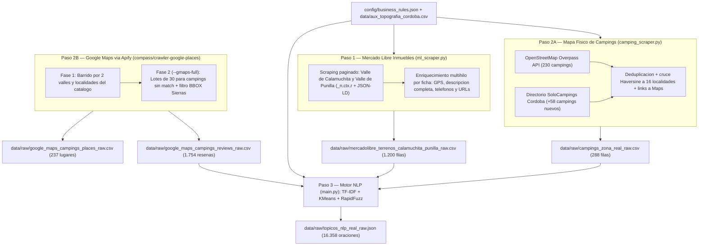

# TerraScout AI — Documentación del Actor de Apify y Flujo de Extracción

Este directorio (`terrascout_actor/`) contiene el **Actor de Apify** y los módulos de extracción y procesamiento NLP que alimentan los datos reales del proyecto **TerraScout & EcoCamp AI** (Sierras de Córdoba: Valles de Calamuchita y Punilla).

---

## 1. Actores de Apify utilizados

El sistema combina **dos actores** (uno propio como contenedor/librería y uno externo oficial del Store de Apify):

| Actor | Tipo | Rol en el proyecto | Cómo se ejecuta |
| :--- | :--- | :--- | :--- |
| **`terrascout-georadar-actor`** (`terrascout_actor/`) | **Actor propio** (basado en plantilla `python-start` de Apify, `Dockerfile` Python 3.14) | Extrae publicaciones de terrenos en **Mercado Libre**, campings reales de **OSM Overpass** y **SoloCampings**, y ejecuta el motor **NLP (`TF-IDF + KMeans` + `RapidFuzz`)**. | En Apify Cloud (`my_actor/main.py`) o localmente vía el orquestador CLI [`src/run_scraper_node.py`](../src/run_scraper_node.py). |
| **`compass/crawler-google-places`** | **Actor externo de Apify Store** (Google Maps Places Crawler) | Extrae lugares reales de Google Maps, ratings (`total_score`), distribución `1★–5★`, `nps_proxy`, teléfonos, webs y reseñas reales en español (`language: "es"`). | Invocado desde [`my_actor/camping_scraper.py`](./my_actor/camping_scraper.py) vía Apify REST API asincrónica (`/v2/acts/compass~crawler-google-places/runs`), autenticado con `APIFY_TOKEN`. |

---

## 2. Flujo completo de extracción y procesamiento



### Detalle de cada etapa

1. **Paso 1 — Mercado Libre Inmuebles ([`my_actor/ml_scraper.py`](./my_actor/ml_scraper.py)):**
   * Recorre las búsquedas paginadas de terrenos en **Calamuchita** y **Punilla** decodificando el estado embebido (`_n.ctx.r`) y JSON-LD (`schema.org`).
   * Enriquecimiento individual concurrente de cada publicación para recuperar coordenadas GPS, descripción completa, extracción de teléfonos/WhatsApp por regex, vendedor y enlaces directos (`url_publicacion`, `url_busqueda`, `url_google_maps`).
2. **Paso 2A — Campings reales gratuitos ([`my_actor/camping_scraper.py`](./my_actor/camping_scraper.py)):**
   * Consulta **OpenStreetMap Overpass** (`tourism=camp_site|caravan_site`) dentro del bounding box de las Sierras de Córdoba y el directorio **SoloCampings Córdoba**.
   * Fusiona y deduplica ambas fuentes, asigna la localidad más cercana con distancia Haversine contra [`data/aux_topografia_cordoba.csv`](../data/aux_topografia_cordoba.csv) y garantiza coordenadas y `url_busqueda_google_maps` en el 100% de las filas.
3. **Paso 2B — Google Maps vía Apify (`compass/crawler-google-places`):**
   * Se ejecuta de forma **asincrónica** (inicia el run, hace polling del estado y descarga el dataset resultante) para evitar cortes por timeout HTTP y rescatar resultados parciales si se agota el saldo de la cuenta.
   * Con `--gmaps-full` opera en dos fases con **guardado incremental (checkpointing) tras cada lote**:
     * **Fase 1:** búsquedas por corredor y por cada localidad (`camping <localidad> Cordoba Argentina`).
     * **Fase 2:** detecta qué campings con nombre de `campings_zona_real_raw.csv` siguen sin coincidencia (por GPS `<= 500 m` o nombre específico) y los consulta en lotes de `30` (`maxCrawledPlacesPerSearch=1`).
   * Filtra cualquier resultado fuera del bounding box de Sierras de Córdoba (`-32.65` a `-30.55` lat, `-65.15` a `-64.05` lon), calcula el **`nps_proxy`** a partir del desglose `1★–5★` y deduce `valle_corredor` usando el catálogo de localidades y GPS.
4. **Paso 3 — NLP y Fuzzy Matching ([`my_actor/main.py`](./my_actor/main.py)):**
   * Consolida títulos/descripciones de Mercado Libre, tags de campings y reseñas de Google Maps.
   * Ejecuta `TF-IDF + KMeans` (automático por `silhouette_score`) para tópicos generales y un clustering específico `topics_quejas_gmaps` sobre reseñas negativas/regulares (`1★–3★`), más `fuzzy_count` (`SentenceIndex` + `RapidFuzz`) para detectar menciones de servicios e infraestructura definidas en [`config/business_rules.json`](../config/business_rules.json).

---

## 3. Estructura del Actor (`terrascout_actor/`)

* `.actor/actor.json` — Metadatos del Actor (`terrascout-georadar-actor`).
* `.actor/input_schema.json` / `dataset_schema.json` / `output_schema.json` — Contratos de entrada y salida para ejecución en Apify Cloud.
* `Dockerfile` y `requirements.txt` — Imagen `apify/actor-python:3.14` con `apify`, `beautifulsoup4`, `rapidfuzz`, `scikit-learn` y `numpy`.
* `my_actor/ml_scraper.py` — Extractor de terrenos en Mercado Libre.
* `my_actor/camping_scraper.py` — Extractor OSM + SoloCampings + cliente Apify `compass/crawler-google-places`.
* `my_actor/main.py` — Motor NLP (`normalize`, `SentenceIndex`, `fuzzy_count`, `find_topics`) y entrypoint asincrónico `Actor`.

---

## 4. Comandos útiles de ejecución (desde la raíz del repo)

```bash
# Pipeline completo (Mercado Libre + Campings + Google Maps + NLP)
python3 src/run_scraper_node.py --max-items-per-valley 600 --max-pages-per-valley 15

# Reutilizar Mercado Libre y campings, y correr extracción intensiva de Google Maps + NLP
python3 src/run_scraper_node.py --gmaps-full

# Reutilizar Mercado Libre y re-correr extracción estándar de campings/GMaps + NLP
python3 src/run_scraper_node.py --gmaps-only

# Recalcular solo tópicos NLP y fuzzy_counts desde los CSV ya guardados (sin scrapear)
python3 src/run_scraper_node.py --nlp-only
```
